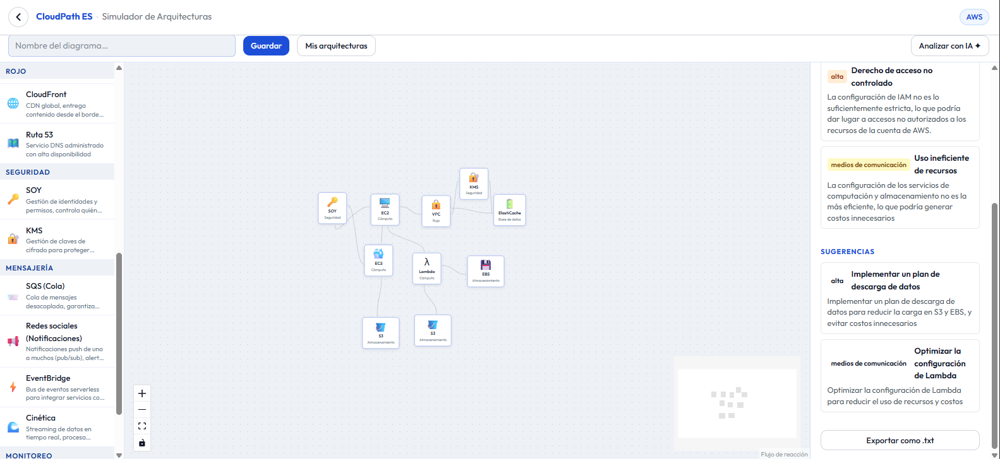

# CloudPath ES

**El camino al cloud, en español.**

Cuando estás empezando a prepararte para una certificación cloud, uno de los primeros obstáculos es que casi todo el material está en inglés. Eso puede desalentarte, confundirte, o simplemente hacerte más difícil entender conceptos que de por sí ya son densos. Y encontrar una herramienta de práctica que no solo funcione, sino que de verdad puedas entender — no es tan fácil.

CloudPath ES nació de esa necesidad. La construí pensando en mí, pero espero que también te sirva a ti.

Es una plataforma open source de estudio para certificaciones cloud, completamente en español, que corre en tu propio equipo sin depender de servicios externos de pago.



---

## Certificaciones que cubre hoy

| Proveedor | Certificación |
|---|---|
| ☁️ AWS | Cloud Practitioner (CLF-C02) |
| 🟡 Google Cloud | Cloud Digital Leader |
| 🔷 Microsoft Azure | Fundamentals (AZ-900) |

La idea es seguir expandiéndola — más certificaciones, más niveles (Associate, Professional), más servicios, y eventualmente otras áreas técnicas como Python, Terraform, Kubernetes y Docker.

---

## Qué puedes hacer con ella

- **Modo Examen** — simulacro cronometrado de 30 preguntas con resultado por dominio, sesión persistida en base de datos (sobrevive reinicios del servidor)
- **Modo Estudio** — una pregunta a la vez con explicación inmediata y selección adaptativa por dominio
- **Modo Repaso** — refuerza los dominios donde tienes menor puntaje histórico
- **Simulador de Arquitecturas** — canvas drag & drop con servicios reales de cada proveedor, conexiones en 4 direcciones
- **Análisis What If con IA** — Ollama analiza tu diagrama y devuelve costo estimado, riesgos y sugerencias (opcional)
- **Tutor IA** — asistente contextual que conoce la pregunta que estás respondiendo; puedes preguntarle por el concepto, pedir que explique la respuesta correcta, o explorar temas relacionados (opcional, requiere Ollama)
- **Generación de preguntas con IA** — genera preguntas adicionales bajo demanda; las preguntas generadas no están verificadas oficialmente y pueden contener inexactitudes (opcional)
- **130+ preguntas verificadas** — AWS, GCP y Azure, incluyendo preguntas multi-respuesta
- **100% gratuita** — sin cuenta, sin suscripción, sin internet obligatorio

> **Nota sobre el formato de examen:** el simulacro usa 30 preguntas para práctica rápida. Los exámenes oficiales tienen más preguntas (AWS CLF-C02: 65 preguntas, 50 puntuables). Un modo de simulacro completo está planeado en la hoja de ruta.

---

## Requisitos del sistema

No necesitas hardware avanzado. Funciona en cualquier equipo moderno.

| Componente | Versión mínima | Notas |
|---|---|---|
| Python | 3.12+ | Gratuito — [python.org](https://python.org) |
| Node.js | 20+ | Gratuito — [nodejs.org](https://nodejs.org) |
| [uv](https://astral.sh/uv) | cualquiera | Gestor de paquetes Python, se instala solo |
| RAM (modo normal) | 512 MB | Sin IA local |
| RAM (con Ollama) | 4 GB recomendado | Solo si activas las funciones de IA |
| Ollama | cualquiera | Opcional — solo para análisis What If y generación de preguntas |
| GPU | No requerida | La IA corre en CPU |
| Sistema operativo | Windows / macOS / Linux | |

---

## Inicio rápido — un solo comando

### Paso 1 — Instalar dependencias (solo la primera vez)

**Windows (PowerShell):**
```powershell
git clone https://github.com/Gusmal02/cloudpath-es.git
cd cloudpath-es
.\setup.ps1
```

**Linux / macOS:**
```bash
git clone https://github.com/Gusmal02/cloudpath-es.git
cd cloudpath-es
chmod +x setup.sh && ./setup.sh
```

### Paso 2 — Iniciar la aplicación

**Windows:**
```powershell
.\start.ps1
```

**Linux / macOS:**
```bash
./start.sh
```

Abre [http://localhost:5173](http://localhost:5173). Las preguntas se cargan automáticamente al iniciar. Presiona `Ctrl+C` para detener backend y frontend a la vez.

### Con Docker (alternativa — un solo comando sin instalar nada)

```bash
docker compose up --build
```

Abre [http://localhost:3000](http://localhost:3000).

---

## IA Local con Ollama (opcional)

Dos funciones usan IA local: el análisis What If del simulador de arquitecturas y la generación de preguntas adicionales. Ambas son completamente opcionales.

1. Descarga [Ollama](https://ollama.com) e instálalo
2. Descarga el modelo: `ollama pull llama3.2:3b` (~2 GB, solo la primera vez)
3. En la app, ve a **Configuración** (ícono ⚙️ en el header) para activar la generación de preguntas

El modelo corre localmente en tu CPU. No envía datos a ningún servidor externo.

---

## Estructura del proyecto

```
cloudpath-es/
├── backend/
│   ├── main.py              # FastAPI app — auto-carga preguntas al iniciar
│   ├── config.py            # Configuración vía variables de entorno
│   ├── database/            # SQLite: sesiones, respuestas, progreso por dominio
│   ├── questions/           # Carga JSON → ChromaDB (RAG), selector adaptativo
│   ├── exam/                # Lógica de sesión: barajar opciones, resultados
│   ├── tutor/               # Motor del tutor IA (contexto por pregunta)
│   ├── whatif/              # Motor What If: prompt builder, cliente Ollama, parser
│   ├── routers/             # /exam, /study, /progress, /admin, /whatif, /generate, /tutor
│   ├── tests/               # Tests de integración con cliente real (pytest)
│   └── data/questions/      # Archivos JSON de preguntas (AWS, GCP, Azure)
├── frontend/
│   └── src/
│       ├── pages/           # Home, ExamMode, StudyMode, ReviewMode, ArchMode, SettingsMode
│       ├── components/      # QuestionCard, Timer, ProgressBar, WhatIfPanel, TutorPanel
│       ├── hooks/           # useStudyFlow — lógica compartida de estudio/repaso
│       ├── context/         # TutorContext — estado global del tutor IA
│       ├── api/client.ts    # Axios hacia /api/* (proxy Vite → backend)
│       └── i18n/es.json     # Todas las cadenas en español
├── docs/
├── docker-compose.yml
├── setup.sh                 # Instala dependencias — Linux/macOS
├── setup.ps1                # Instala dependencias — Windows
├── start.sh                 # Inicia backend + frontend — Linux/macOS
└── start.ps1                # Inicia backend + frontend — Windows
```

---

## Agregar preguntas manualmente

Crea un archivo `.json` en `backend/data/questions/`:

```json
[
  {
    "id": "unique-id",
    "text": "¿Pregunta en español?",
    "options": ["Opción A", "Opción B", "Opción C", "Opción D"],
    "correct_index": 0,
    "explanation": "Explicación detallada.",
    "domain": "CLOUD_CONCEPTS",
    "provider": "AWS"
  }
]
```

**Proveedores válidos:** `AWS`, `GCP`, `AZURE`

**Dominios válidos:** `CLOUD_CONCEPTS`, `SECURITY`, `TECHNOLOGY`, `BILLING`, `AI_ML`

Reinicia el backend y las preguntas se indexan automáticamente.

---

## Variables de entorno (backend)

| Variable | Default | Descripción |
|----------|---------|-------------|
| `CLOUDPATH_DB_PATH` | `data/cloudpath.db` | Base de datos SQLite |
| `CLOUDPATH_CHROMA_PATH` | `data/chroma` | Directorio ChromaDB |
| `CLOUDPATH_QUESTIONS_DIR` | `data/questions` | Directorio de preguntas JSON |
| `OLLAMA_URL` | `http://localhost:11434` | URL de Ollama |
| `OLLAMA_MODEL` | `llama3.2:3b` | Modelo de Ollama a usar |

---

## Visión del proyecto

CloudPath ES está pensada para crecer. El objetivo es convertirse en la plataforma de referencia en español para preparar certificaciones cloud y tecnología en general — sin barreras de idioma, sin costo, y sin depender de la nube para funcionar.

**Próximas certificaciones planeadas:**
- AWS Solutions Architect Associate
- AWS Developer Associate
- GCP Associate Cloud Engineer
- Azure Administrator (AZ-104)

**Próximas mejoras técnicas:**
- Modo simulacro completo (65 preguntas, condiciones reales del examen)
- Validación de preguntas generadas por IA contra material de referencia oficial
- Cobertura CLF-C02 ajustada a los pesos reales por dominio

**Próximas áreas de expansión:**
- Python para DevOps
- Terraform e Infraestructura como Código
- Kubernetes y Docker
- Seguridad en la nube

Si quieres contribuir, reportar un error, o proponer una mejora, las contribuciones son bienvenidas.

---

## Licencia

MIT — libre para usar, modificar y distribuir.
